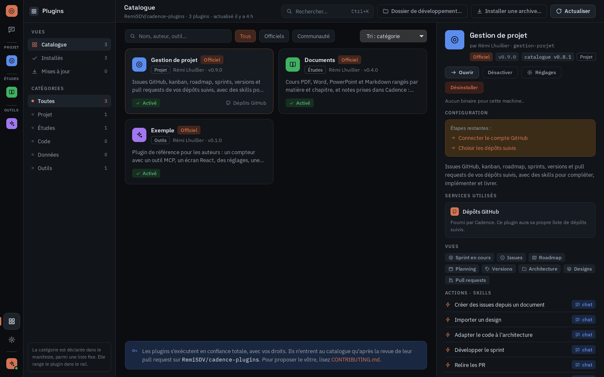
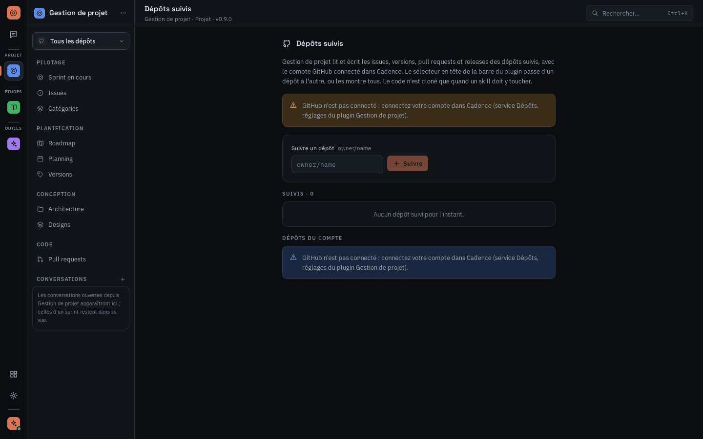
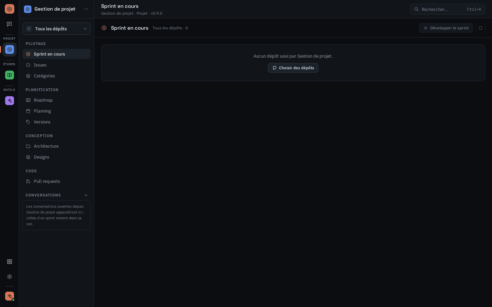
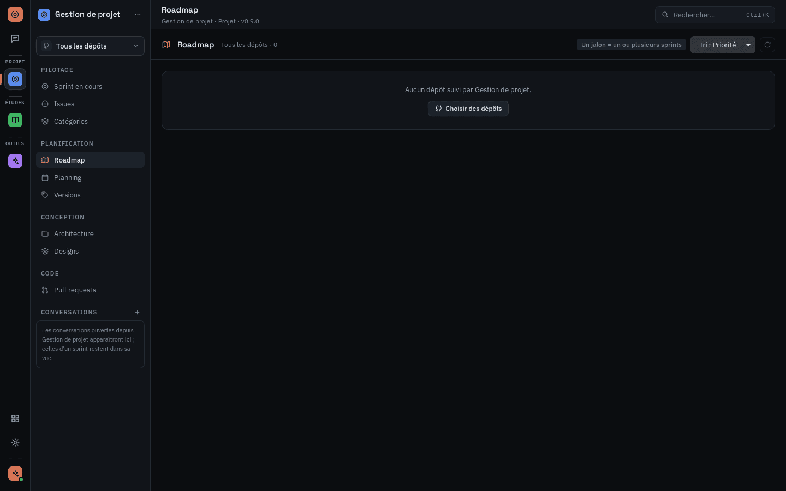
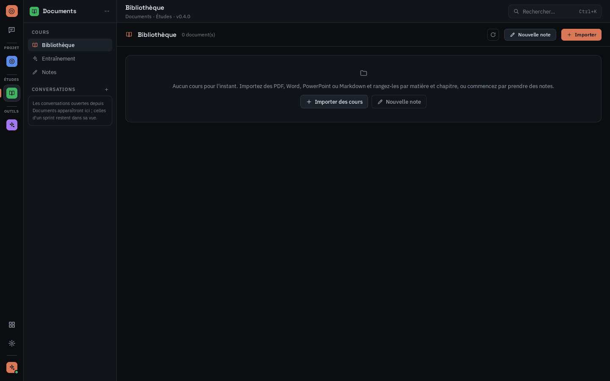
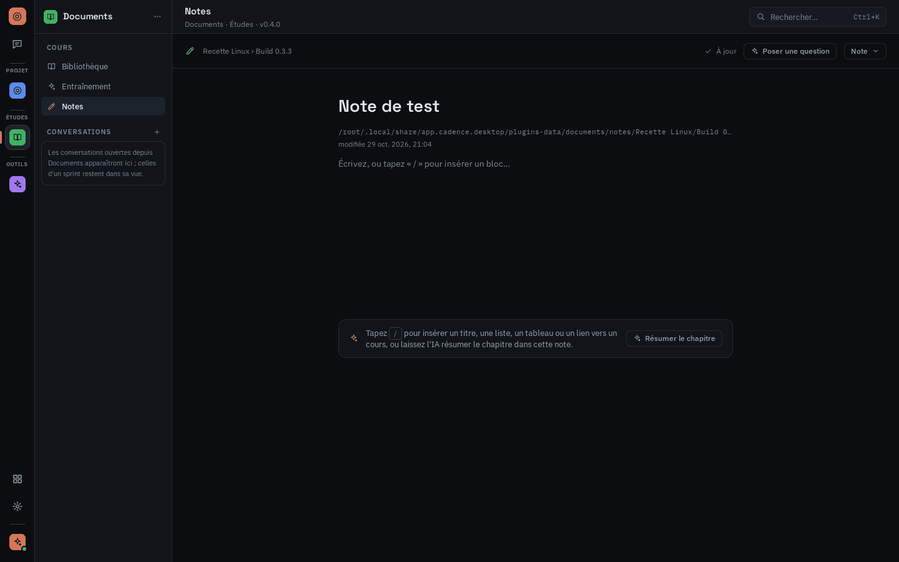
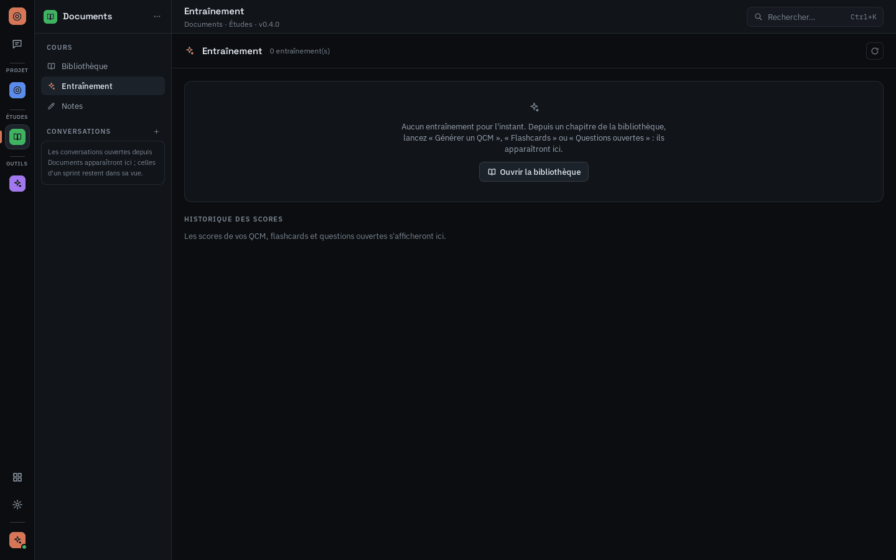

# Guide d'utilisation des plugins

Ce guide explique comment installer les plugins dans Cadence et s'en servir au quotidien.
Présentation : [README](../README.md). Utilisation de l'app elle-même :
[guide de Cadence](https://github.com/RemiSDV/cadence/blob/master/docs/utilisation.md).

1. [Installer, mettre à jour, retirer](#1-installer-mettre-à-jour-retirer)
2. [Gestion de projet](#2-gestion-de-projet)
3. [Documents](#3-documents)
4. [Exemple](#4-exemple)

## 1. Installer, mettre à jour, retirer



- **Installer** : dans Cadence, ouvrez le **catalogue** (icône en grille en bas du rail), cliquez
  sur un plugin puis sur **Installer**. Cadence télécharge le plugin, vérifie son empreinte et
  l'active : il prend place dans le rail, dans le groupe de sa catégorie (Projet, Études, Outils…).
  Vous pouvez aussi cocher les plugins voulus pendant l'onboarding.
- **Configurer** : si le plugin a besoin de quelque chose (un compte GitHub, un dossier, un outil
  comme Git), Cadence l'indique et propose de l'installer ou de le connecter.
- **Mettre à jour** : la vue « Mises à jour » du catalogue liste les nouvelles versions ; elles
  peuvent aussi s'installer seules (Réglages › Général › « Mettre à jour les plugins
  automatiquement »).
- **Désactiver ou désinstaller** : depuis la fiche du plugin dans le catalogue. Ses données sont
  conservées.
- **Installer une archive** : un plugin reçu sous forme de `.zip` s'installe avec « Installer une
  archive… », en haut du catalogue.

> **Linux** : Gestion de projet et Documents ne sont pas encore publiés pour Linux, et le catalogue
> les marque « Incompatible ». En attendant, construisez-les depuis ce dépôt (Node 20+, pnpm,
> Rust) :
>
> ```bash
> pnpm install && pnpm build && cargo build --release
> mkdir -p bins/linux-x86_64 && cp target/release/cadence-gestion-projet target/release/cadence-documents bins/linux-x86_64/
> pnpm package gestion-projet --bins bins --allow-missing-targets
> pnpm package documents --bins bins --allow-missing-targets
> ```
>
> puis installez les archives de `out/` avec « Installer une archive… ».

## 2. Gestion de projet

Gestion de projet pilote un ou plusieurs dépôts GitHub. Il apparaît dans le groupe **Projet** du
rail.

### Démarrer

1. **Connecter GitHub** : Réglages › Dépôts GitHub › « Se connecter avec GitHub » (compte de la
   CLI `gh`, navigateur, code d'appairage ou jeton personnel).
2. **Choisir des dépôts** : le bouton apparaît sur chaque écran tant qu'aucun dépôt n'est suivi.
   Collez `propriétaire/nom` ou choisissez parmi les dépôts de votre compte.
3. Le **sélecteur** en haut de la barre du plugin passe d'un dépôt à l'autre, ou affiche
   « Tous les dépôts ».



### Les écrans

| Écran               | À quoi il sert                                                                                                                          |
| ------------------- | --------------------------------------------------------------------------------------------------------------------------------------- |
| **Sprint en cours** | « Démarrer le projet » (durée et capacité des sprints), tableau des tâches par état, burndown, tâches à relire, conversations du sprint |
| **Issues**          | table groupée par catégorie, état, version ou priorité ; modification en ligne ; « Nouvelle issue », « Depuis un document »             |
| **Catégories**      | domaines et catégories qui rangent les issues                                                                                           |
| **Roadmap**         | jalons, avancement et date de fin estimée, « Proposer des issues »                                                                      |
| **Planning**        | diagramme de Gantt libre (phases, personnes, dépendances), « Planifier avec l'IA »                                                      |
| **Versions**        | versions ouvertes et livrées, notes de version, « Préparer la release »                                                                 |
| **Architecture**    | services et couches du projet, « Adapter le code à l'architecture »                                                                     |
| **Designs**         | maquettes Claude Design, « Créer des issues depuis ce design »                                                                          |
| **Pull requests**   | PR ouvertes et fermées, CI, revues, « Relire les PR »                                                                                   |

| Sprint en cours                                                                  | Roadmap                                                                   |
| -------------------------------------------------------------------------------- | ------------------------------------------------------------------------- |
|  |  |

### Sprints automatiques

« Démarrer le projet » (écran Sprint en cours) demande la durée d'un sprint (un jour à quatre
semaines), sa capacité en story points et la première version. Ensuite, Cadence enchaîne seul :
un sprint correspond à une version, il se remplit dans l'ordre de la roadmap et des priorités, et la
capacité s'ajuste au rythme réel. Vous pouvez mettre en pause, changer la durée ou clore un sprint
en avance.

### Les actions de l'IA

Les boutons lancent l'IA sur une tâche précise. Certaines actions ouvrent une conversation dans le
chat, d'autres travaillent en fond.

- **Compléter l'issue** et **Découper l'issue** : précisent ou découpent une issue.
- **Implémenter** (en fond) : l'IA code l'issue dans une copie de travail dédiée et ouvre une pull
  request.
- **Développer le sprint** : implémente les issues du sprint.
- **Relire et valider** : depuis la colonne « En revue » du sprint, relit une ou plusieurs tâches
  cochées, rend un verdict, puis, **après votre confirmation**, approuve, fusionne et ferme
  l'issue. Une PR dont la CI est rouge n'est jamais fusionnée.
- **Proposer des issues** (Roadmap), **Planifier avec l'IA** (Planning), **Préparer la release**
  (Versions), **Créer des issues depuis un document** ou **depuis un design**.

L'IA ne pousse jamais sur la branche par défaut ; les pull requests et les releases sont créées en
brouillon. Les conversations lancées depuis un sprint se retrouvent dans « Conversations du
sprint ».

Détails complets (outils de l'IA, réglages, catégories, sprints) : [README du
plugin](../plugins/gestion-projet/README.md).

## 3. Documents

Documents range vos cours et vos notes. Il apparaît dans le groupe **Études** du rail.

### Ranger ses cours

Dans **Bibliothèque**, « Importer » ajoute des fichiers PDF, Word (.docx), PowerPoint (.pptx),
Markdown ou texte, rangés en **Matière → Chapitre**. Un clic sur un document l'ouvre page par page.



### Prendre des notes

« Nouvelle note » demande une matière, un chapitre et un titre, puis ouvre l'éditeur :

- tapez **`/`** pour insérer un titre, une liste, une case à cocher, un tableau, un bloc de code ou
  un **lien vers un cours** (une page précise ou une autre note) ;
- les raccourcis Markdown marchent à la frappe (`# `, `- `, `[] `, `**gras**`…) ;
- glissez la poignée **⋮⋮** à gauche d'un bloc pour le déplacer ;
- l'enregistrement est automatique (ou `Ctrl+S`). Les notes sont de simples fichiers Markdown,
  modifiables aussi hors de Cadence.

Sur une note vide, « Résumer le chapitre » demande à l'IA de la rédiger.



### Réviser avec l'IA

Depuis un chapitre :

- **Poser une question** : l'IA répond dans le chat en citant le document et la page ; les
  citations sont cliquables ;
- **Générer un QCM** et **Flashcards** (en fond) : l'entraînement apparaît dans **Entraînement**.
  QCM : touches 1 à 9, correction avec explication et source. Flashcards : espace pour retourner,
  1 « À revoir », 2 « Je savais » ;
- **Questions ouvertes** : l'IA pose les questions et corrige vos réponses dans le chat.

L'historique des scores est dans **Entraînement**.



Détails complets : [README du plugin](../plugins/documents/README.md).

## 4. Exemple

Exemple est le plugin modèle pour les auteurs : un compteur à incrémenter, un prénom à régler et
une action « Saluer » qui ouvre le chat. Il ne sert qu'à montrer comment un plugin s'intègre à
Cadence ; pour en écrire un, voir la [documentation technique](technique.md) et le [README du
plugin](../plugins/exemple/README.md).


