# Gestion de projet

**Vos dépôts GitHub pilotés depuis Cadence : issues rangées par catégorie, sprints automatiques,
roadmap, planning, versions et pull requests, avec l'IA pour compléter, développer et relire.**

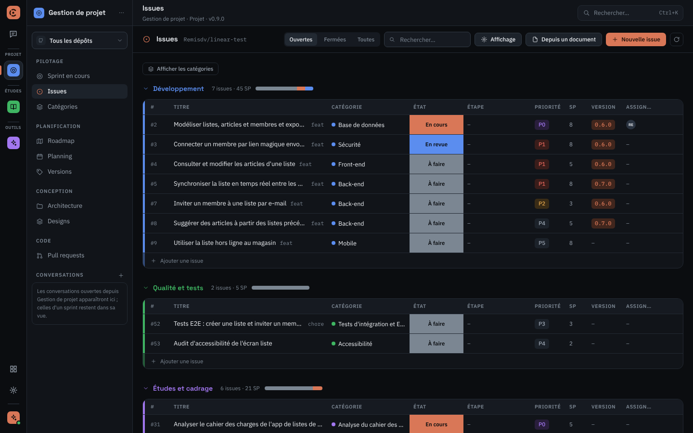

Plugin officiel, groupe **Projet** du rail. Version 0.9.0. Il travaille directement sur vos dépôts
GitHub : les issues, labels, milestones et pull requests restent la source de vérité, et toute
l'équipe voit la même chose, dans Cadence comme sur GitHub.

## Un cas réel : une app de listes de courses pour un client

Les captures de cette page viennent du dépôt d'essai `Remisdv/linear-test`. On y mène un petit
projet client : une application web de listes de courses partagées (listes, articles, membres
invités, synchronisation en temps réel, mode hors ligne au magasin). Le projet couvre tout ce qu'on
fait pour un client, pas seulement le code : cadrage, questions au client, documents à rédiger,
sprints de développement et mise en production.

### 1. Tout le projet dans une seule table

La vue **Issues** range les 31 issues ouvertes par **domaine**, avec une couleur par domaine. Chaque
groupe affiche son nombre d'issues, ses story points et la répartition des états (barre à droite
du titre). La catégorie, l'état, l'étape et la priorité se changent directement dans la cellule ;
Cadence met à jour les labels de l'issue sur GitHub.

| Domaine                       | Exemples du projet                                                       |
| ----------------------------- | ------------------------------------------------------------------------ |
| **Développement**             | #2 Modéliser listes, articles et membres · #3 Connexion par lien magique |
| **Qualité et tests**          | #52 Tests E2E : créer une liste et inviter un membre                     |
| **Études et cadrage**         | #31 Analyser le cahier des charges · #34 Cadrer la V1 : ce qu'on descope |
| **Échanges client**           | #37 Mail de questions au client · #38 Relance sur les maquettes          |
| **Documentation**             | #42 Rédiger le DAT · #43 Spécifications fonctionnelles (SFD)             |
| **Gestion de projet**         | #46 Recaler le Gantt · #47 Préparer le COPIL de novembre                 |
| **Design et UX**              | #54 Maquettes des écrans liste et article                                |
| **Livraison et exploitation** | #55 Mise en production de la V1                                          |

Le menu **Affichage** change le regroupement (domaine, catégorie, état, version, priorité ou aucun),
le tri (priorité, roadmap, numéro, activité) et les colonnes affichées.

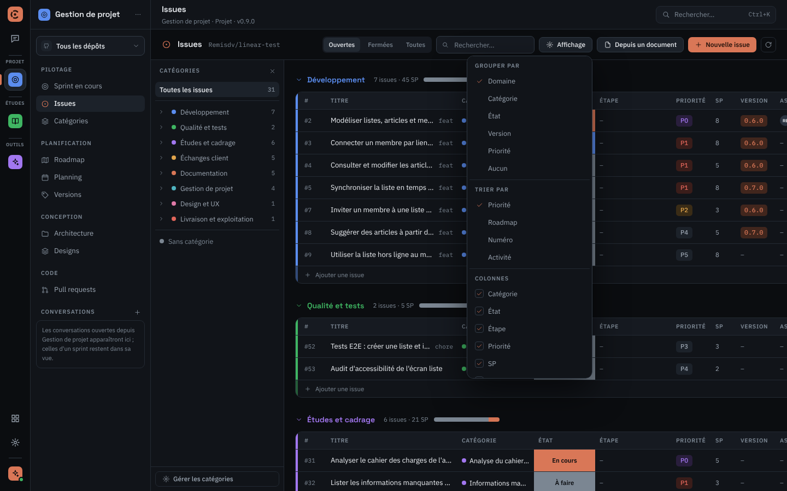

### 2. Les échanges client suivent un pipeline

L'arbre des catégories, à gauche, filtre la table : un clic sur **Échanges client** n'affiche plus
que les mails, relances, demandes et comptes rendus. Ces issues suivent un **pipeline d'étapes** :
À préparer → Envoyé → En attente de réponse → Relancé → Réponse reçue → Traité. Les petites barres
sous l'étape montrent l'avancement. Les documents suivent le leur : À rédiger → En rédaction → En
relecture → Validé → Diffusé.

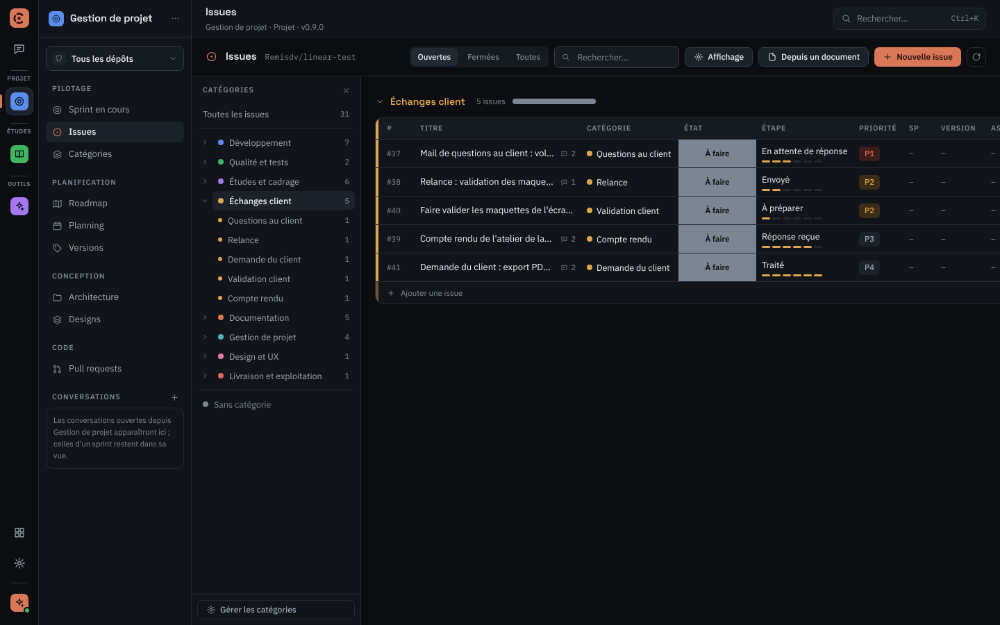

Chaque passage d'étape est **historisé en commentaire** sur l'issue. Le mail de questions #37 (sur la
volumétrie, le nombre de membres par liste et l'authentification) garde ainsi la trace de son envoi
le 24/10, puis de l'accusé de réception :

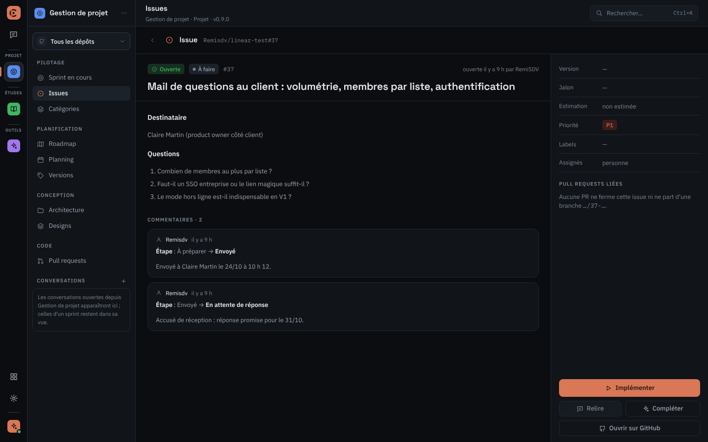

### 3. Les catégories sont celles de l'équipe

La vue **Catégories** présente les huit domaines livrés et leurs catégories : back-end, CI/CD,
note de cadrage, DAT, relance, COPIL… Chaque catégorie correspond à un label `cat/…`. On peut masquer
celles qui ne servent pas, et ajouter ses propres catégories et domaines, avec une couleur et un
pipeline facultatif. Ces réglages sont enregistrés dans le dépôt : toute l'équipe partage les
mêmes.

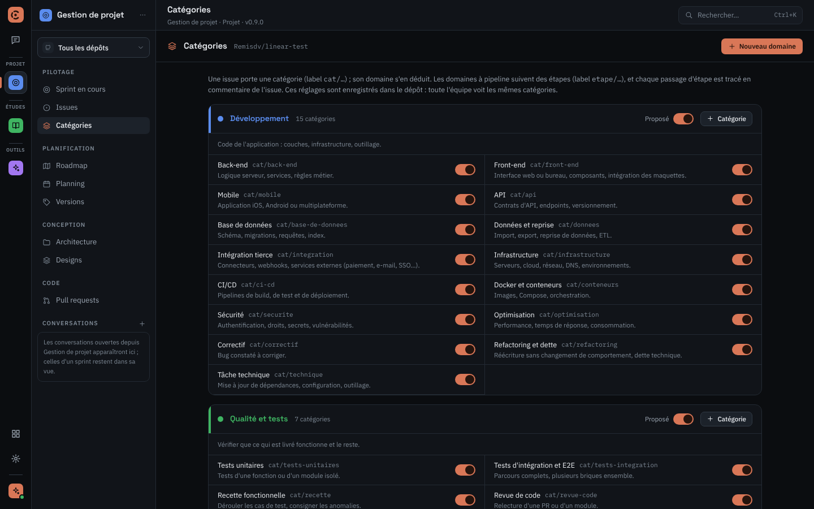

### 4. Des sprints qui s'enchaînent seuls

« Démarrer le projet » fixe la durée des sprints (ici deux semaines), leur capacité en story points
et la première version. Ensuite, Cadence enchaîne seul : chaque sprint est une version (milestone
GitHub) avec sa branche `release/x.y.z`, et se remplit dans l'ordre de la roadmap et des
priorités. Le sprint **0.6.0 « Listes et membres »** du projet montre l'avancement, le reste à faire,
le rythme réel et le retard, avec le kanban, le burndown et les conversations de l'IA de ce sprint.

Sur ce sprint, l'IA implémente #2 en fond. #3 « Connexion par lien magique » attend sa revue : la PR
#58 est verte (4/4), et **Relire** lance la relecture. Après votre accord, l'IA approuve, fusionne et
ferme l'issue. Une PR dont la CI est rouge n'est jamais fusionnée.

### 5. Roadmap, planning et pull requests

La **Roadmap** regroupe les issues en jalons (« Socle et données », « Listes partagées », « V1 mobile et
hors ligne »). Elle les place sur les sprints passés et à venir, et estime une date de fin d'après
le rythme réel de l'équipe.

| Planning (Gantt du projet)                                                             | Pull requests                                                                                    |
| -------------------------------------------------------------------------------------- | ------------------------------------------------------------------------------------------------ |
| 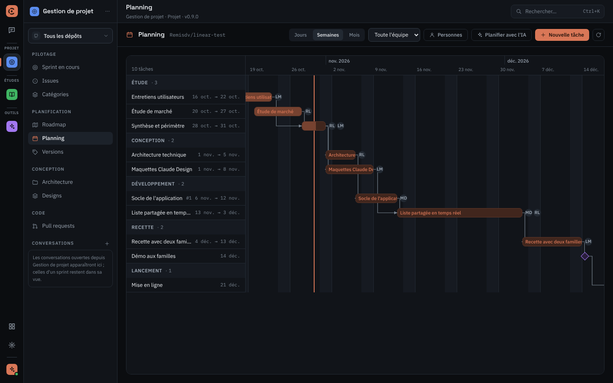 | 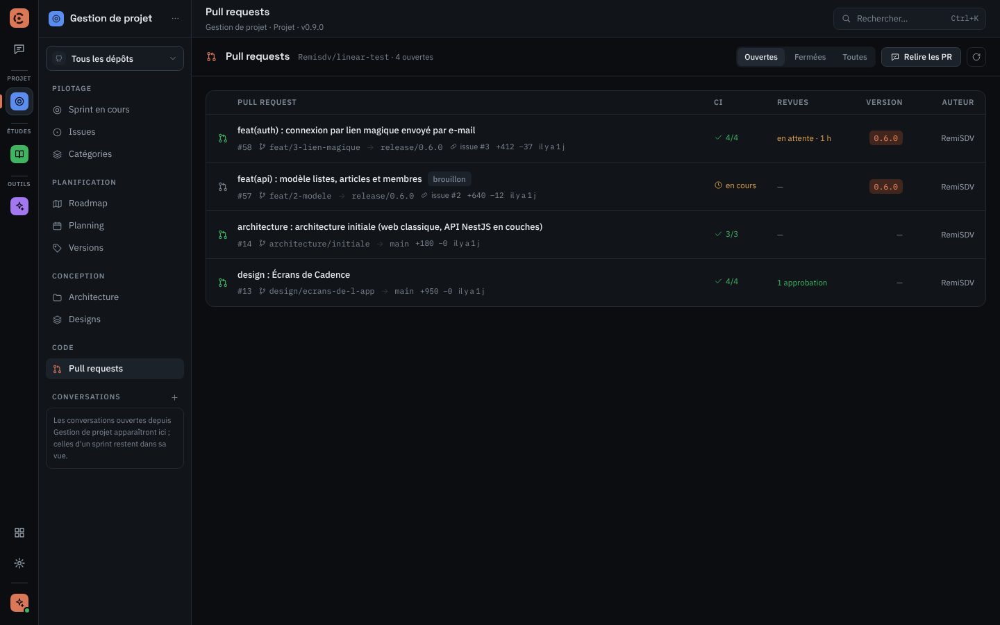 |

Le **Planning** est un Gantt libre : phases d'étude, de conception, de développement, de recette et
de lancement, avec les personnes, les dépendances et l'avancement. « Planifier avec l'IA » le
propose à partir des issues. **Pull requests** liste les PR avec leur CI, leurs revues, leur
version et l'issue liée.

### 6. L'architecture et les maquettes sont dans le dépôt

La vue **Architecture** décrit le projet en deux niveaux. D'abord le **système** : ici Nginx, le front
React, l'API NestJS et PostgreSQL, avec leurs liens (REST, WebSocket pour le temps réel, SQL). Puis
les **couches** de chaque service, avec leur rôle, les dépendances autorisées, les règles et les
conventions. L'API suit le modèle « API REST en couches » (controller, service, repository, DTO,
entité, mapper). L'architecture est enregistrée dans le dépôt par une pull request (ici #14).
« Adapter le code » demande à l'IA de corriger les écarts.

| Système                                                                                                  | Couches de l'API                                                                                                          |
| -------------------------------------------------------------------------------------------------------- | ------------------------------------------------------------------------------------------------------------------------- |
| 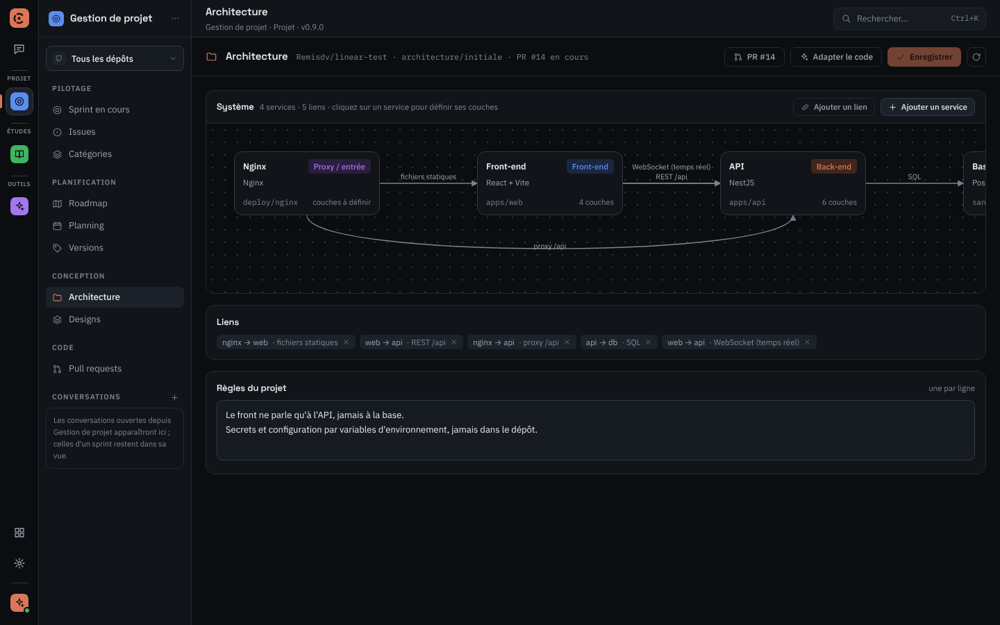 | 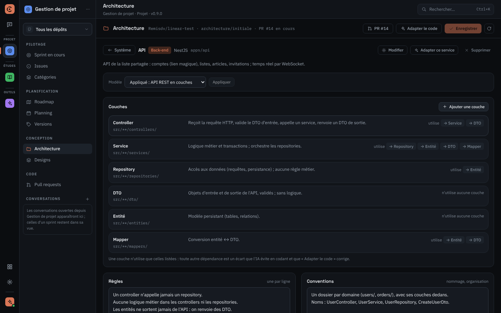 |

La vue **Designs** importe les maquettes de Claude Design dans le dépôt (dossier `design/`) et les
affiche dans une visionneuse. Le design « Écrans de l'app » présente la liste des listes, une liste
partagée et l'invitation d'un membre, au format téléphone. « Créer des issues depuis ce design »
transforme les écrans en issues ; « Créer un design » en commande un nouveau à l'IA.

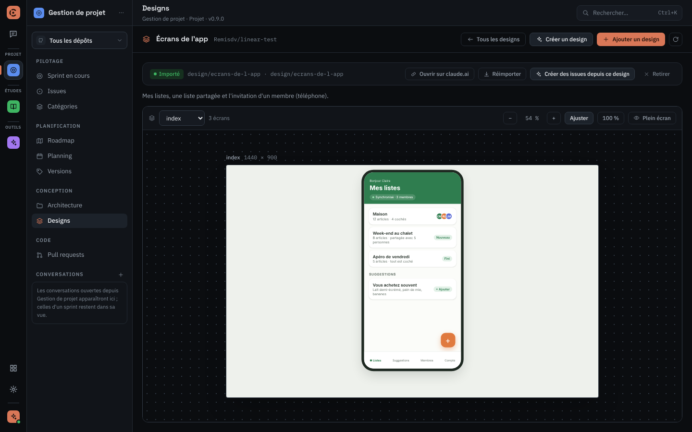

### 7. Livrer une version

La vue **Versions** suit chaque version : avancement en story points, PR fusionnées, jours restants,
rythme requis, portée, notes de version et burndown. Elle indique aussi ce qui bloque encore la
clôture (issues ouvertes, PR non fusionnées, CI). « Préparer la release » rédige les notes et crée
la PR de release et la release en brouillon.

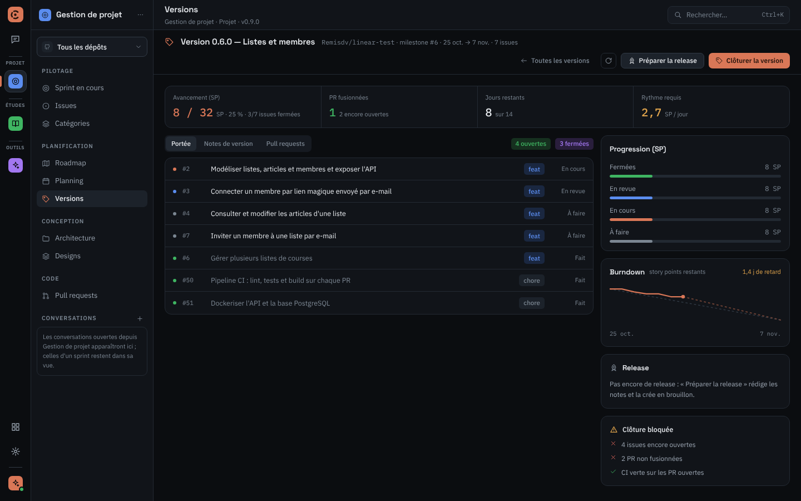

## Ce que fait l'IA

Les boutons lancent l'IA de code que vous avez choisie (Claude Code, Codex CLI ou OpenCode) sur une
tâche précise :

| Action                                                     | Où                           | Ce qu'elle fait                                                           |
| ---------------------------------------------------------- | ---------------------------- | ------------------------------------------------------------------------- |
| **Compléter l'issue**, **Découper l'issue**                | Issues, fiche d'issue        | précise le contexte et les critères d'acceptation, ou découpe en tâches   |
| **Implémenter**                                            | Issues, sprint               | code l'issue dans une copie de travail dédiée et ouvre une PR             |
| **Développer le sprint**                                   | Sprint en cours              | enchaîne les issues du sprint                                             |
| **Relire et valider**                                      | Sprint, colonne « En revue » | relit une ou plusieurs PR, puis approuve et fusionne après votre accord   |
| **Depuis un document**                                     | Issues                       | crée des issues chiffrées depuis un cahier des charges ou un compte rendu |
| **Proposer des issues**                                    | Roadmap                      | complète un jalon                                                         |
| **Planifier avec l'IA**                                    | Planning                     | construit le Gantt                                                        |
| **Adapter le code à l'architecture**                       | Architecture                 | corrige les dépendances entre couches qui ne respectent pas les règles    |
| **Créer des issues depuis ce design**, **Créer un design** | Designs                      | découpe les écrans en issues, ou commande un design à l'IA                |
| **Préparer la release**                                    | Versions                     | notes de version, PR de release et release en brouillon                   |

L'IA ne pousse jamais sur la branche par défaut. Les pull requests et les releases sont créées en
brouillon.

## Démarrer

1. Dans Cadence, ouvrez le **catalogue** (icône en grille en bas du rail) et installez
   **Gestion de projet**.
2. Connectez GitHub : Réglages › Dépôts GitHub › « Se connecter avec GitHub » (avec le compte de la
   CLI `gh`, par le navigateur, avec un code d'appairage ou un jeton personnel).
3. Choisissez les dépôts à suivre. Le sélecteur en haut de la barre du plugin passe de l'un à
   l'autre, ou affiche « Tous les dépôts ».
4. Sur **Sprint en cours**, « Démarrer le projet » lance les sprints automatiques.

## Données et réseau

Le plugin ne contacte que l'API GitHub (`api.github.com`), avec la connexion GitHub de Cadence.
Votre jeton reste au trousseau du système. Rien n'est stocké en local : catégories, sprints et
jalons sont enregistrés dans le dépôt (labels, milestones, issue d'état).

## Pour aller plus loin

- [Guide d'utilisation](../../docs/utilisation.md#2-gestion-de-projet) : écrans, sprints, actions.
- [Référence technique](TECHNIQUE.md) : écrans, actions et skills, outils MCP, catégories, sprints
  automatiques, développement du plugin.

Captures : Cadence 0.3.4 et Gestion de projet 0.9.0, avec les issues, catégories, étapes et
commentaires du dépôt d'essai `Remisdv/linear-test`, et son architecture (PR #14). Le sprint 0.6.0,
ses PR, ses conversations et les écrans du design ont été complétés pour l'exemple.
